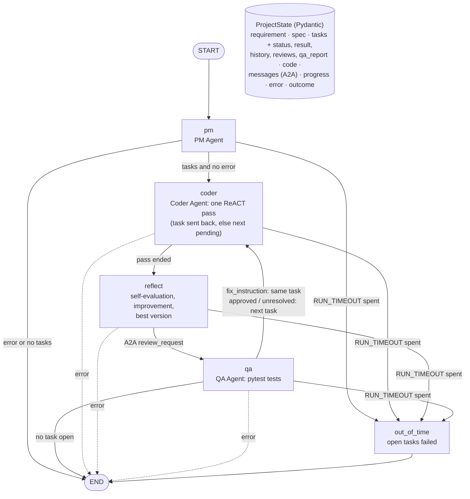

# Multi-Agent Dev Team

Final project of the **Build Autonomous Multi-Agent Systems** course (Saras AI
Institute): an autonomous software team of LLM agents that takes a natural
language requirement and produces tested, working Python code, with no human
intervention after the first prompt.

The project is built one module at a time. **Current state: Module 3 —
Agent Team v3.0**: a PM Agent turns the requirement into a spec and at most
8 tasks; for each task the Coder Agent (Module 1: two-tier memory, validated
tools, ReACT loop, structured output) writes the code, evaluates its own
version and improves it, and sends it to a QA & Debugger Agent that writes
and runs pytest tests and answers over **A2A** messages: approved, or a fix
instruction that sends the task back to the Coder, at most
`QA_MAX_ITERATIONS` times. Everything runs in one LangGraph graph over a
typed shared state. Docker and observability arrive in Module 4.

## Framework

**[LangGraph](https://langchain-ai.github.io/langgraph/)**, for every agent and
for the orchestration (DEC-068); unchanged in Modules 2 and 3. The Coder's
ReACT loop is LangChain's `create_agent`, which builds a LangGraph graph,
with native tool calling and our own middleware (DEC-069). The PM's
structured calls, the Coder's self-evaluation and the QA's test drafts use
Pydantic-validated outputs (`create_agent` with `ToolStrategy` or
`with_structured_output`, DEC-091). The team graph is a LangGraph
`StateGraph` (DEC-094) whose nodes are `pm`, `coder`, `reflect`, `qa` and
`out_of_time`.

Why LangGraph:
- **Explicit control flow.** Nodes and conditional edges decide what runs
  next, so the limits the assessor forces (10 ReACT iterations, the QA→Coder
  loop limit, the run's time limit, task order) are conditions in the
  graph, not left to the LLM.
- **Typed shared state** is native, as the PM → Coder → QA handoff needs;
  the A2A messages travel in it too (DEC-175).
- **The standard agent loop with hooks.** `create_agent` brings the loop, a
  model-call limit and a validated final answer; middleware adds what a
  Coder needs on top: memory injected on every call, tool arguments
  validated before any tool runs, and no task ending without the `Finish`
  tool.
- **Tracing and tests.** LangSmith traces the graph (Module 4), and fake chat
  models make the mocked agent tests simple.
- Trade-off: more code than CrewAI to define roles, and no free-form agent
  conversation (AutoGen's strength); our flow PM → Coder → QA is a fixed
  sequence with bounded loops, so neither is needed.

**LLM:** any model with tool calling through [OpenRouter](https://openrouter.ai),
used with LangChain's `ChatOpenAI` because OpenRouter speaks the OpenAI API
for every model (DEC-075); an equivalent of the GPT-4o / Claude Sonnet options
in the course guide. Each LLM call has its own timeout, `LLM_TIMEOUT`
(DEC-166). Models per role:

| Role | Variable | Default | Why |
|---|---|---|---|
| Coder (ReACT passes) | `LLM_MODEL` | `openai/gpt-4.1-mini` | Many calls per task: small and fast (DEC-086) |
| QA (test drafts, fixes) | `QA_MODEL` | `openai/gpt-4.1-mini` | Small and fast; executed tests decide, not the model (DEC-150) |
| PM | `PM_MODEL` | `openai/gpt-4.1` | 2-4 calls per run that plan the whole project (DEC-093) |
| Coder's self-evaluation | `EVALUATION_MODEL` | `openai/gpt-4.1` | 1-2 calls per review; the small model was not reliable at judging code (DEC-200) |

## Setup

Python **3.11**, with [uv](https://docs.astral.sh/uv/) (DEC-032):

```bash
uv venv --python 3.11 .venv
UV_LINK_MODE=copy uv pip install -r requirements.txt   # UV_LINK_MODE only needed on /mnt/c (WSL)
source .venv/bin/activate
cp .env.example .env    # then set OPENROUTER_API_KEY
```

Credentials only come from environment variables (`.env`, never committed).
Every setting in `.env.example` is documented there: the models and the LLM
timeout, log level, memory (window size, memories per call, Chroma
location), tools (script timeout, 10 s by default and 30 s maximum, read
limit, the Coder's workspace), the MCP client's timeout, the QA (its
folder, model, attempts and per-test timeout) and the Coder-QA loop
(`QA_MAX_ITERATIONS`, `RUN_TIMEOUT`, `REFLECTION_MAX_ROUNDS`). The loop
settings are read and validated when each run starts (DEC-180).

## Running the team

```bash
python main.py                  # the graded Module 2 demo task: a Flask API with /health and /echo
python main.py "Implement a Python module that contains a linked list class with insert, delete, search, and reverse methods. All methods must be covered by tests."
python main.py --json           # the whole final ProjectState as JSON, outcome included
QA_MAX_ITERATIONS=2 RUN_TIMEOUT=600 python main.py   # tighter loop limits for one run
```

Each run goes from the requirement to the code with no human input
(DEC-096). Before it starts, everything an earlier run left in `workspace_coder/`
is **moved, never deleted**, to `workspace_coder_history/<timestamp>/`, so each
run starts with an empty workspace (DEC-114). The output lists:

- `[PROGRESS]`: one note per step, in order: the PM's spec and tasks
  ("handoff ready"), then for each task the Coder's pass, the version
  `reflect` sends ("Reflect: task_1 sends v1 for review 1") and the QA's
  verdict ("QA: task_1 done — approved at review 1", or "review 2 of 5 not
  approved; back to the Coder"). With the default `LOG_LEVEL=INFO`, each
  note is also logged live as soon as its step ends (DEC-120), together
  with one line per A2A message.
- `[SPEC]`, `[ACCEPTANCE CRITERIA]` and `[TASKS]`: the PM's spec and each
  task with its priority, status, files, the spec criteria it covers, the
  tasks it was merged from (when more than 8 were consolidated), its
  Given/When/Then criteria and a `result:` line (main file, iterations,
  first line of the last run's output).
- `[WORKSPACE]`: the folder and the files the run wrote.
- `[FINAL REPORT]` when a task was not approved, or `ERROR:` if the run
  ended with an error.
- The **verdict**, always the last line (DEC-181).

### Success or unresolved issues

A run succeeds **only** when there is no error and **the QA approved every
task** (`ProjectState.outcome == "success"`, DEC-165). A task is `done` only
when the QA's executed tests all passed; the Coder alone never closes a task
(DEC-178). The last line and the exit code say which:

| Last line | Exit code | Meaning |
|---|---|---|
| `RESULT: success` | 0 | The QA approved every task. |
| `RESULT: unresolved — task_2 not approved` | 1 | The run finished, but the listed tasks were not approved; `[FINAL REPORT]` above it says why. Also `no tasks were planned`. |
| `RESULT: error — <message>` | 1 | The run stopped: the PM failed, the workspace could not be archived, the Coder hit a fatal error or the step limit was reached. |
| (usage message) | 2 | Invalid usage, e.g. an empty requirement. |

An unresolved run **never** says success. Its final report has one block
per task that is not approved: why it closed, the review it stopped at and
its blocking issues from the QA's last report (DEC-181):

```
[FINAL REPORT] tasks not approved
- task_2 — review limit reached; stopped at review 5
    [High] test_task_2.py::test_reverse_single: reverse() on a one-node list raised AttributeError
```

The reasons are `review limit reached` (review `QA_MAX_ITERATIONS` not
approved), `the QA could not review it` (the QA failed twice, DEC-169),
`A2A protocol error` (DEC-170), `out of time` (`RUN_TIMEOUT` spent,
DEC-168) and `not run` (a task the run never reached). The remaining tasks
still run after a task fails (DEC-164). With `--json` only the state is
printed; the exit code still gives the verdict, and `outcome`, each task's
`status`, `closed_reason` and `qa_report` give the details.

### Trying the generated API

The Coder never starts a server, since a server never ends: `exec_python`
refuses a file that starts one, and the Coder checks its API with a separate
script that calls it in-process through `app.test_client()` (DEC-112,
DEC-116). The API file keeps an `if __name__ == "__main__":` block that
starts the server, so you can run it yourself:

```bash
python workspace_coder/app.py   # the file name is the task's main file in the output
curl http://127.0.0.1:5000/health
curl -X POST -H "Content-Type: application/json" -d '{"a": 1}' http://127.0.0.1:5000/echo
```

## How the team works (Module 3)



Every node reads and writes the shared state (`orchestration/state.py`);
nothing is copied by hand between agents. The edges are in
`orchestration/graph.py`.

1. **`run()`** archives the workspace, reads the loop settings, sets the
   run's deadline (`RUN_TIMEOUT`, monotonic clock) and streams the graph
   with a step limit of `1 + 8 × QA_MAX_ITERATIONS × 3 + 3` (124 by
   default), a guard against routing bugs that keeps the state (DEC-114,
   DEC-180, DEC-198).
2. **`pm`** (`agents/pm_agent.py`) makes two structured calls: the spec
   (name, description, markdown details, acceptance criteria), then the
   tasks, each with an ID, description, Given/When/Then criteria, the spec
   criteria it covers, files (at least one `.py`) and priority. Every
   output is validated with Pydantic and gets one corrective retry
   (DEC-083, DEC-087, DEC-088, DEC-095, DEC-117). More than 8 tasks are
   merged deterministically into 8 groups of consecutive tasks, keeping
   every covered criterion (DEC-082, DEC-092). The PM never raises: a
   failure is written to `error`.
3. **Handoff** (`route_after_pm`): the Coder runs only when the PM left no
   error and at least one task. The tasks in the state, with status
   `pending`, are the handoff; they are JSON-serializable (`--json`)
   (DEC-110).
4. **`coder`** (`agents/coder_agent.py`) runs **one ReACT pass** of the
   Module 1 agent: on the task the QA sent back, else on the `pending` task
   with the lowest priority (DEC-085, DEC-103, DEC-119). A first pass gets
   the task, its criteria, the project context and its files; a correction
   pass also gets the QA's fix instructions with the failing tests' code
   and the task's review history (DEC-184, DEC-187, DEC-195). The task
   stays `in_progress`; only the QA closes it (DEC-178).
5. **`reflect`** (`agents/coder_reflection.py`) is the Coder's
   **self-reflection before QA**: it evaluates the version, improves it
   when it finds High or Medium bugs, puts the best version on disk and
   sends it to the QA in an A2A `review_request` (see below).
6. **`qa`** (`agents/qa_agent.py`) reviews that version with executed
   pytest tests and answers over A2A: `approved` (task `done`),
   `fix_instruction` (back to the Coder for review n + 1) or `unresolved`
   (review n = `QA_MAX_ITERATIONS` not approved: task `failed` with the
   QA's report). One review is one iteration of the loop; each task has
   its own limit, and review `QA_MAX_ITERATIONS + 1` never starts (DEC-163,
   DEC-176).
7. **`route_after_qa`** goes back to the Coder while a task is open; a
   failed task does not stop the next ones (DEC-164). Every router sends
   the run to **`out_of_time`** once the deadline has passed, which closes
   the open tasks `failed` ("out of time") and keeps the work done
   (DEC-168, DEC-198).

| `ProjectState` field | Written by | Read by |
|---|---|---|
| `requirement` | `run()` | PM |
| `spec`: name, description, details, acceptance criteria, tasks as planned | PM | Coder (project context), `main.py` |
| `tasks`: each `TaskSpec` plus `status` (`pending`/`in_progress`/`done`/`failed`), `result` (`CoderResult`), `reflection`, `reviews`, `history`, `qa_report`, `closed_reason` | PM creates them; Coder, `reflect` and QA update them | every node, routers, `main.py` |
| `code`: file path → content on disk, every file the run wrote | Coder | Coder (files already written), `main.py` |
| `messages`: the A2A messages of the run | `reflect` (`review_request`), QA (answers) | QA, Coder, tests |
| `progress`: notes, appended by each step | every node | `main.py` |
| `error`: empty unless the run must stop | `run()`, PM, Coder | routers, `main.py` |
| `deadline`, `deadline_at`: end of the run's time budget | `run()` | routers |
| `outcome`: `success` or `unresolved`, computed from the tasks | — | `main.py`, `--json` |

### Coder ↔ QA over A2A (C3.5)

The graded protocol route is **A2A**, used for the Coder ↔ QA review loop
(DEC-162). Why: the review loop is a dialogue between two agents, which is
what A2A models; MCP models an agent's access to tools, so through it the
agents would only talk indirectly through shared files. The loop had to be
built anyway, so A2A is its envelope, and the Coder's Module 1 tools stay
untouched. The QA still reads the Coder's files through the Lab 3.1 MCP
server (below), but that pathway is not the graded route.

Every message is an `A2AMessage` (Pydantic, `orchestration/a2a.py`) with
**`sender`**, **`receiver`**, **`intent`**, **`payload`** and
**`correlation_id`**. It validates itself: known agents, `sender ≠
receiver`, an intent its receiver accepts (the QA accepts only
`review_request`; the Coder only `fix_instruction`, `approved` and
`unresolved`) and a payload of the model its intent requires (DEC-176,
DEC-189). `send` also checks that a reply answers the open request with
the same `correlation_id`. Messages travel in `ProjectState.messages`, a
mailbox in the shared state, so the loop stays inside the one graph
(C2.3) and every message is in `--json` (DEC-175).

| Intent | From → to | Payload |
|---|---|---|
| `review_request` | coder → qa | task ID, review number n, limit |
| `fix_instruction` | qa → coder | the QA report: one issue and fix per failing test |
| `approved` | qa → coder | the QA report (all tests passed) |
| `unresolved` | qa → coder | the final report, at the limit or after the QA failed twice |

An invalid message is never acted on: it is logged at ERROR and its task
closes `failed` with a protocol-error issue (DEC-170). Each message is
logged when sent, one INFO line:

```
A2A coder -> qa intent=review_request task=task_2 review=1 correlation_id=e0c26eaf-...
A2A qa -> coder intent=fix_instruction task=task_2 review=1 correlation_id=e0c26eaf-...
```

### Self-reflection before QA (C3.4)

The `reflect` node runs after every Coder pass and before every QA review
(DEC-172, DEC-177, DEC-196):

1. **Evaluate** the version with one structured call (`EVALUATION_MODEL`)
   against a fixed rubric: one item per acceptance criterion of the task
   (C0..Cn) plus E1-E11 (empty input, boundaries, repeated values, invalid
   input, interface, state across calls, safe import, security, type
   annotations, style, any other defect). Each item is `ok`, `bug` or `n/a`
   with evidence; each bug names its defect kind and carries a diagnosis
   (location, concrete input, cause, minimal fix). The code maps each kind
   to a severity: High (`logic_error`, `crash`, `security`), Medium
   (`missing_edge_case`, `unclear_error`), Low (annotations, style, naming,
   docstrings) (DEC-182, DEC-183, DEC-200).
2. **Improve** only if the version has High or Medium bugs: a ReACT pass
   of the Coder gets the diagnosis and fixes and runs the code, so `result`
   still comes from a real execution (C1.5). Up to `REFLECTION_MAX_ROUNDS`
   rounds per submission.
3. **Rank** the versions by their bug counts compared in order (High, then
   Medium, then Low; a tie goes to the improved version), **restore the
   best one on disk** and send it to the QA. A worse improvement is never
   sent (DEC-182, DEC-196).

A version with only Low bugs (or none) is sent unchanged: an improvement
pass costs up to 11 LLM calls, and annotations, style and docstrings are
not what the QA's tests check (DEC-182). The log shows every step
(`critique v0: C2 High logic_error ...`, `v0: 1 High, 0 Medium, 2 Low`,
`v1: 0 High, 0 Medium, 0 Low`, `sent v1`). Evidence that the critique
drives a revision and the revised artifact is the one sent: the
planted-bug test AC-3.3-41 (`tests/test_reflection.py`, a `reverse` that
loses nodes is found as High, fixed in v1 and v1 is sent) and its log in
[`docs/evidence/lab_3_3/`](docs/evidence/lab_3_3/). If the evaluation gives
no valid output in two calls, the version goes to the QA as it is and the
log says so (DEC-171).

### QA & Debugger Agent (C3.1)

`run_qa` (`agents/qa_agent.py`) is a fixed pipeline, not a ReACT agent
(DEC-144):

1. Reads the task's files from the Coder's workspace **through the MCP
   server** (DEC-145); it never writes the Coder's code (DEC-122).
2. Asks `QA_MODEL` for a draft of pytest tests, one per acceptance
   criterion or edge case, written from the criteria and the code's
   interface, not its bodies; the draft is validated with a per-task
   Pydantic schema (DEC-148, DEC-157, DEC-158).
3. Writes the tests to its own folder, `workspace_qa/`, never overlapping
   the Coder's, and runs pytest in the shared sandbox: a subprocess with a
   timeout (`QA_TEST_TIMEOUT` per test), no credentials and isolated from
   the project's pytest configuration (DEC-140, DEC-146, DEC-155, DEC-161).
   Results come from pytest's JUnit XML report and exit code (DEC-147).
4. **Only executed tests create issues**: each failing test is a High
   issue with its location, description, the test's code, the criterion
   and a fix instruction written by a second call that reads the whole code
   (`review_code`); the LLM explains failures but never adds issues or
   decides approval (DEC-174, DEC-191).
5. Returns a `QAReport` whose `approved` is computed: tests ran and none
   failed (DEC-149, DEC-153).

A broken draft of its own (collection error, skipped test) makes it write a
new one within `QA_MAX_ATTEMPTS` model calls; anything that stops the QA
becomes an unapproved report with `qa` issues, never a crash (DEC-141,
DEC-142, DEC-152). In the loop, a review that failed because of the QA is
repeated once without charging the Coder a review (DEC-169).

```bash
python -m agents.qa_agent    # demo: reviews a bundled buggy linked list with the real model
```

### MCP file server (Lab 3.1)

`tools/mcp_server.py` is an MCP server built with the official Python SDK
(`mcp>=1.30,<2`, low-level `Server`, DEC-129, DEC-130). It serves the
Coder's workspace (`CODER_WORKSPACE_DIR`) over stdio (DEC-124, DEC-125):

- tool **`read_file`** (`path` relative to the workspace): the file's
  content, capped at `READ_MAX_CHARS`;
- resource **`file://project/listing`**: every file of the workspace,
  recursive, as relative paths.

It reuses the safety rules of the Coder's tools: strict Pydantic arguments,
confinement to the workspace (`..`, absolute paths and symlinks that leave
it are rejected), hidden entries (`.env`, `.git/`) and `__pycache__/` are
neither listed nor read, and the file really read is checked, not only the
name asked for (DEC-126, DEC-131, DEC-136). Errors are `isError` results
whose text starts with `ERROR:` and names only relative paths; the server
never crashes on a bad request. Each request is logged once to **stderr**
(stdout carries the protocol) with the server's PID, rejected ones at
WARNING; client values are escaped and file contents are never logged
(DEC-127, DEC-136).

`tools/mcp_client.py` starts the server as a child process
(`python -m tools.mcp_server`) with the workspace set explicitly, and waits
at most `MCP_TIMEOUT` seconds per request (DEC-132, DEC-135). The QA uses
its `read_multiple_files`. Demo:

```bash
python -m tools.mcp_client app.py   # prints the tools, the resources, the listing and app.py
```

The demo prints its own PID; the server's log lines, with the server's
PID, appear on stderr, which shows the file was read by another process
through the protocol.

### Memory in the loop

Every Coder pass keeps both memory layers of Module 1: the sliding window
and the Chroma store, queried before each of its LLM calls and injected
into the prompt (C1.2, DEC-186). The QA's fix instructions reach Chroma
through the Coder's correction prompts, so a later task can recall them.
Two LLM calls use no memory on purpose: the PM and the QA, as before, and
the **Coder's self-evaluation**, which sees only the version's files and
the task, with no window and no Chroma. An evaluator that cannot read the
author's reasoning judges the code that is there instead of agreeing with
it, and its opinions never leak into the Coder's memory (DEC-173). The
window keeps whole passes during the loop; compacting them is left for
Module 4's cost data (DEC-185).

## Running the Coder Agent alone (Module 1)

```bash
# Interactive session: each message is a task that runs the ReACT loop
python -m agents.coder_agent

# One task: prints the whole CoderResult as JSON
python -m agents.coder_agent "Write is_palindrome(s) in palindrome.py and test it"
```

The Coder works inside `workspace_coder/` (git-ignored, set by `CODER_WORKSPACE_DIR`): every path it uses is
confined there, and scripts run in a child process with a timeout and without
the agent's credentials. `LOG_LEVEL=INFO` logs the plan, one line per
iteration (tool called, or a text answer sent back) and one per LLM call
(window size and memories retrieved); `LOG_LEVEL=DEBUG` adds the full LLM
input.

### How it works

- **Plan** (`agents/coder_agent.py`): before the loop, one LLM call returns
  a Pydantic-validated `Plan`; it goes into the loop's prompt and into the
  output. It does not count as an iteration (DEC-070, DEC-071).
- **ReACT loop**: a `create_agent` graph with native tool calling, at most
  **10 model calls** per task (DEC-069, DEC-079). Each response calls exactly
  one tool (DEC-074), and every tool has a required `thought` argument, the
  Thought of that step (DEC-072). The task ends only through the `Finish`
  tool (`main_file` or null, `explanation`), validated with Pydantic; a
  response with text and no tool call goes back to the model as an error
  and counts as an iteration (DEC-073).
- **Tools** (`tools/`): `read_file`, `write_file`, `exec_python`. The model
  sees the lab schemas plus `thought` (`tools/agent_tools.py`); a middleware
  validates every call with strict Pydantic models before it runs, and
  `dispatch_tool` validates again and never raises, so invalid arguments
  never reach a tool (DEC-042, DEC-062, DEC-076).
- **Memory** (`memory.py`): a sliding window of the last N tasks of the
  session (each task with all its iterations is one turn), and a Chroma
  semantic store queried **before every LLM call** (the plan call and each
  call of the loop), whose results are injected into the system prompt. It
  stores each task and the outcome of each finished task (DEC-049, DEC-057,
  DEC-058, DEC-077).

### Output and statuses

Every task returns a `CoderResult` (Pydantic) with `status`, `plan` (from
the planning step), `code` (read from the main file on disk), `explanation`,
`result` (output of the last real execution), `main_file`, `iterations` and
`steps` (thought, action, input and observation of each step). It is computed
from the agent's messages after the run (DEC-078).

The status describes the evidence the task produced, not the kind of
request:

| Status | Meaning |
|---|---|
| `success` | `Finish` with a main file this task wrote or ran; the file exists and its last run (with no file written after it) ended without error. |
| `failed_execution` | `Finish` with a main file, but the last valid run failed. |
| `unverified` | `Finish` with a main file but no valid run: never ran, files changed after the run, or the declared file does not exist. |
| `answered` | `Finish` without code from this task (for example a question, even one about a file from an earlier task); nothing was executed (DEC-056, DEC-080). |
| `max_iterations` | 10 model calls without `Finish`. |

Only `success` means the code was checked by a real execution. In the team
graph it is the QA's verdict, not this status, that closes a task
(DEC-178).

## Tests

```bash
pytest tests/                                      # every mocked test, no LLM calls
pytest tests/ --run-llm                            # also the tests with the real LLM (costs tokens)
pytest tests/test_integration_pipeline.py --run-llm -k graded_demo   # only the Module 2 graded demo
pytest tests/test_integration_loop.py --run-llm -k 40                # the Module 3 linked-list demo
pytest tests/test_reflection.py --run-llm -k 41                      # self-reflection on a planted bug
CHROMA_PATH=.chroma-test python -m tests.test_memory   # Lab 1.1 recall test, real LLM
```

Every test runs in temporary workspaces, so your `workspace_coder/` and
`workspace_qa/` are never touched. Without `--run-llm`, a test that would
reach a real model fails instead of calling it; the tests marked `llm` are
skipped, and with `--run-llm` and no API key they fail. Test names start
with the acceptance criterion they check (`test_ac_3_3_30_...` checks
AC-3.3-30 of `docs/specs/lab_3_3_a2a_loop.md`).

| Area | Files | What they check |
|---|---|---|
| Tools | `test_file_io.py`, `test_code_executor.py`, `test_server_guard.py`, `test_workspace.py`, `test_workspace_settings.py` | File reads and writes, script and pytest output, errors and timeouts, a file starting a web server is never run (DEC-116), workspace archive and folder settings |
| MCP | `test_mcp_server.py`, `test_mcp_client.py` | The real server in memory and over stdio: `read_file`, the listing, rejected paths (outside, hidden, symlinks), truncation, errors, the log lines, the client's timeout |
| PM | `test_pm_agent.py`, `test_llm_helpers.py` | Spec and task schemas (every task has a `.py` file), the corrective retry, consolidation of more than 8 tasks with every criterion still covered |
| Shared state and A2A | `test_state.py`, `test_a2a.py`, `test_qa_report.py` | Invalid values are rejected and the state survives a JSON round trip; A2A messages with an unknown intent or agent, `sender == receiver`, a wrong payload or a wrong `correlation_id` are rejected; the **QA issue schema** and its computed `approved` |
| Coder node | `test_coder_node.py`, `test_coder_passes.py` | One task per step: its prompt, status, result and accumulated code; the prompts of first, improvement and correction passes |
| Self-reflection | `test_reflection.py` | The rubric schema, kind → severity, the ranking, improvement only on High/Medium bugs, the best version restored and sent, an unavailable evaluation |
| QA | `test_qa_agent.py` | Real pytest runs on mocked code input: correct code approved, failing tests become High issues with their fix and code, broken drafts retried, timeouts, the Coder's folder untouched |
| Graph and loop | `test_pipeline.py`, `test_integration_pm.py`, `test_integration_coder.py`, `test_integration_pipeline.py`, `test_integration_loop.py`, `test_loop_settings.py` | The PM → Coder handoff in one graph; **loop success** (AC-3.3-29), **loop max iterations**: exactly `QA_MAX_ITERATIONS` reviews, task failed, run unresolved (AC-3.3-30); QA feedback driving a revision with the real QA (AC-3.3-31); QA failure retried, protocol error, next task after a failure, out of time; loop settings from the environment |
| Entry point | `test_main.py` | Output, final report, `RESULT:` verdict and exit codes |
| Real LLM (`llm`) | `test_smoke.py`, `test_integration_pm.py`, `test_integration_coder.py`, `test_integration_pipeline.py`, `test_qa_agent.py`, `test_reflection.py`, `test_integration_loop.py` | A Coder task run; the PM's spec; the **Module 2 graded demo**, whose API passes the request fixture in `tests/api_fixture.py`; the live QA; the planted-bug self-reflection (AC-3.3-41); the **linked-list demo** through the whole team, whose QA tests call `insert`, `delete`, `search` and `reverse` and pass (AC-3.3-40) |
| Request fixture | `test_api_fixture.py` | The fixture passes a correct API and fails one that answers 415 to a body that is not JSON (DEC-118) |

The mocked tests use scripted fake chat models (`tests/fakes.py`), so they
check the agents' and the graph's behavior without an API key.

**Live evidence** of Module 3 (INFO logs of real runs) is in
[`docs/evidence/lab_3_3/`](docs/evidence/lab_3_3/) (DEC-199): the planted-bug
self-reflection, the linked-list demo from pytest and from `main.py`
(`RESULT: success`), and a run where the QA sent a task back four times
and approved it at review 5, the last allowed.

## Repository layout

```
main.py          entry point: runs the team for a requirement
agents/          pm_agent.py (PM node), coder_agent.py (Coder and its graph node),
                 coder_reflection.py (self-reflection, reflect node),
                 qa_agent.py (QA and its graph node), llm_helpers.py (validated structured calls)
tools/           file_io.py, code_executor.py, handlers.py (validation, dispatch), schemas.py,
                 agent_tools.py (LangChain adapter), mcp_server.py, mcp_client.py
orchestration/   graph.py (team graph and run()), state.py (shared state), a2a.py (A2A messages),
                 qa_report.py (QA issues and report), settings.py (loop settings),
                 workspace.py (archive)
tests/           pytest tests, fakes, the API request fixture (api_fixture.py)
docs/            decisions.md, improvements.md, specs/ (one per lab), labs/, evidence/,
                 course_reference.txt
memory.py        two-tier memory
llm_client.py    shared chat model (ChatOpenAI → OpenRouter)
workspace_coder/ the Coder's working folder (git-ignored)
workspace_qa/    the QA's tests (git-ignored)
workspace_coder_history/  files of earlier runs (git-ignored)
```

`Dockerfile` and `docker-compose.yml` are placeholders until Module 4.

## Design decisions (Module 1)

Key decisions by rubric criterion. The full record, with the alternatives
considered, is in [`docs/decisions.md`](docs/decisions.md); the code cites
each `DEC-NNN` it applies. Ideas beyond the requirements are in
[`docs/improvements.md`](docs/improvements.md).

**C1.1 Project setup**
- Labs live inside the required scaffold; shared modules (`memory.py`,
  `llm_client.py`) sit at the root, split by responsibility — DEC-001,
  DEC-033, DEC-035
- LangGraph as the framework; the Coder is a `create_agent` graph —
  DEC-068, DEC-069
- LLM through OpenRouter with LangChain's `ChatOpenAI`; model set by
  `LLM_MODEL` and passed per agent — DEC-002, DEC-075
- Python 3.11 locally via uv — DEC-032

**C1.2 Memory**
- The window keeps the last N turns; a turn is one task with all its
  iterations — DEC-004, DEC-048, DEC-057
- Chroma with local embeddings (no extra API key) and an on-disk store, so
  memories survive between runs — DEC-003
- Retrieval runs before every LLM call (a middleware rebuilds the input of
  each model call), queried by the task, and its results go into the system
  message; memories already in the window are skipped — DEC-015, DEC-016,
  DEC-050, DEC-058, DEC-077
- Stored: each task and the outcome of each finished task, not tool
  observations — DEC-049, DEC-059
- A failed LLM call raises and leaves the window untouched — DEC-027,
  DEC-028, DEC-031
- Every LLM call logs the window state and the memories retrieved — DEC-025

**C1.3 Tools**
- File tools work only inside `workspace_coder/`; arguments are validated by strict
  Pydantic models — DEC-036, DEC-042
- Scripts run in a subprocess with a 10 s default timeout (env var, 30 s
  cap); on timeout the whole process group is killed — DEC-037, DEC-044,
  DEC-045
- Scripts get an allowlisted environment, so no credentials — DEC-039,
  DEC-043
- `exec_python` always returns a useful text (output, exit code or timeout)
  — DEC-038
- Every tool call is validated with strict Pydantic models before the tool
  runs, with short error messages; `dispatch_tool` validates again and never
  raises — DEC-062, DEC-067, DEC-076

**C1.4 ReACT loop**
- Native tool calling in a `create_agent` loop; at most 10 model calls,
  enforced by LangChain's call limit placed last in the middleware —
  DEC-069, DEC-070, DEC-079
- A validated `Plan` before the loop — DEC-071
- Every tool call carries a `thought`; one tool per call; the task ends only
  through `Finish`, and text answers go back as errors — DEC-072, DEC-073,
  DEC-074
- Every step is recorded in `steps` — DEC-078

**C1.5 Structured output**
- `CoderResult` (Pydantic) is the output of a whole task — DEC-065
- `code` is read from the main file the agent declares, so it matches the
  written artifact — DEC-052
- `result` comes from the last real execution with no file written after it;
  the status says how the task ended — DEC-055, DEC-056, DEC-063
- A declared main file only counts if this task wrote or ran it; an existing
  file from an earlier task makes the answer `answered`, a missing one
  `unverified` — DEC-080

**C1.6 Verification**
- The smoke test runs a real task with the real LLM (opt-in with
  `--run-llm`) and checks the generated code's behavior in a subprocess —
  DEC-054, DEC-066

**Known simplifications** (provisional, to revisit)
- Memory deduplication only catches exact repeats — DEC-011
- One run id per process, no session id — DEC-014
- Retrieval returns the top K without a relevance threshold — DEC-017
- LLM retries are `ChatOpenAI`'s defaults until Module 4 (C4.2) — DEC-075

## Design decisions (Module 2)

Specs with the acceptance criteria and tests of each lab:
[`docs/specs/`](docs/specs/) (PM Agent, Coder node, pipeline).

**C2.1 Specification**
- The PM is a fixed two-call pipeline, spec then tasks, on a larger model
  (`PM_MODEL`); it never raises, failures end in `error` — DEC-086, DEC-087,
  DEC-093
- The spec has name, description, markdown details and acceptance criteria;
  every criterion must be covered by a task — DEC-083
- 2 to 8 tasks, as few as the requirement allows; several tasks may extend
  the same file; every task changes Python code — DEC-081, DEC-084, DEC-117
- Task criteria are structured Given/When/Then — DEC-095
- Each structured call is Pydantic-validated (`create_agent` with
  `ToolStrategy`) and an invalid output gets one corrective retry —
  DEC-088, DEC-091

**C2.2 Shared state**
- `ProjectState` is a Pydantic model; the graph is built on it — DEC-089
- The spec keeps the tasks as planned; `tasks` holds them as executed, with
  status and `CoderResult` — DEC-090, DEC-101, DEC-107
- `code` holds the files each task actually wrote, read from disk — DEC-106

**C2.3 Handoff**
- PM and Coder are nodes of one LangGraph graph in `orchestration/` —
  DEC-094, DEC-100
- The Coder runs only when the PM left no error and at least one task;
  the pending tasks in the state are the handoff — DEC-110
- The node turns a task (ID, description, criteria, files) plus the project
  context and existing files into the Coder's prompt — DEC-098, DEC-105

**C2.4 Execution and progress**
- Priority is the execution order; the Coder runs the pending task with
  the lowest priority, one per step, and loops while tasks are pending —
  DEC-085, DEC-103, DEC-119
- Each progress note is logged as soon as its step ends — DEC-120
- More than 8 tasks are merged into 8 even groups of consecutive tasks,
  keeping their criteria and `merged_from` — DEC-082, DEC-092
- A failed task does not stop the others; a fatal error ends the run — DEC-097,
  DEC-102
- One memory window per run, shared by its tasks and passed in the run
  context — DEC-099, DEC-104, DEC-109
- A step limit ends a runaway loop and keeps the state; since Module 3 it
  follows the loop limit — DEC-115, superseded by DEC-180

**C2.5 Working two-agent system**
- Flask is a project dependency, so generated APIs can run — DEC-108
- The Coder never runs a server: `exec_python` refuses a file that starts
  one, and APIs are checked with a script that calls them in-process; the
  API file still serves when run with `python` — DEC-112, DEC-116
- A body that is not JSON gets 400 whatever its content type, and the
  request fixture checks four such bodies — DEC-118
- Every agent is told that Flask is the only third-party package
  installed, so no plan asks for FastAPI or other packages — DEC-121
- A run succeeds only with no error and every task done; the verdict line
  and the exit code say so — DEC-111, superseded in Module 3 by DEC-181
  (`done` now means approved by the QA)

**C2.6 Explanation**
- Framework unchanged from Module 1 (LangGraph) — DEC-068
- `main.py` runs the graded demo by default and can print the state as JSON
  — DEC-096

**Known simplifications** (provisional, to revisit)
- Each run starts with an empty workspace (earlier files are archived to
  `workspace_coder_history/`); continuing an existing project is a future
  improvement (IMP-011) — DEC-114
- After a fatal error, `code` may miss files the failed task wrote (IMP-009)

## Design decisions (Module 3)

Specs: [`docs/specs/lab_3_1_mcp_server.md`](docs/specs/lab_3_1_mcp_server.md),
[`lab_3_2_qa_agent.md`](docs/specs/lab_3_2_qa_agent.md) and
[`lab_3_3_a2a_loop.md`](docs/specs/lab_3_3_a2a_loop.md).

**C3.1 QA agent**
- The QA writes real pytest tests from each task's acceptance criteria and
  runs them in the sandbox with a timeout — DEC-137, DEC-138, DEC-146
- Only executed tests create issues and grant approval; the LLM only
  writes the fix of each failing test — DEC-149, DEC-174
- A fixed pipeline on a small model, reading through MCP, writing only in
  its own folder — DEC-122, DEC-140, DEC-144, DEC-145, DEC-150
- A QA that cannot do its job returns an unapproved report, never a crash —
  DEC-141, DEC-142

**C3.2 Review loop**
- Each task is reviewed in its own loop; a failing review sends the task
  back to the Coder with the QA's fix instructions and the test code —
  DEC-163, DEC-187, DEC-191
- Each task keeps its review history in the state — DEC-184
- Only the QA's verdict closes a task — DEC-178

**C3.3 Termination**
- `QA_MAX_ITERATIONS` (default 5) reviews per task, read per run; at the
  limit the QA answers `unresolved` with the report of unresolved issues —
  DEC-163, DEC-176, DEC-180
- The task stays failed and the run goes on; the run is `success` only if
  every task was approved, with a final report and exit code 1 otherwise —
  DEC-164, DEC-165, DEC-181
- `RUN_TIMEOUT` per run and `LLM_TIMEOUT` per call bound the whole run —
  DEC-166, DEC-168, DEC-198
- A failure of the QA itself is retried once and never charged to the Coder
  — DEC-169

**C3.4 Self-reflection**
- A `reflect` node between the Coder and the QA evaluates every version
  against a rubric, improves it on High/Medium bugs and sends the best —
  DEC-172, DEC-177, DEC-182, DEC-183, DEC-196
- A version with only Low bugs is sent unchanged; the critique-driven
  revision is shown by AC-3.3-41 and `docs/evidence/lab_3_3/` — DEC-182
- The evaluation uses a larger model and no memory — DEC-173, DEC-200

**C3.5 Protocol**
- A2A for the Coder ↔ QA loop; MCP stays as the QA's file access — DEC-162
- Five-field messages that validate their intent and payload, in a mailbox
  in the shared state, each one logged — DEC-175, DEC-176, DEC-189
- An invalid message closes its task as a protocol error — DEC-170

**C3.6 Tests**
- Mocked tests of the QA issue schema, loop success and loop max
  iterations; the live linked-list demo passes the QA's generated tests for
  all four methods — AC-3.3-29, AC-3.3-30, AC-3.3-40, DEC-199

**Known simplifications** (provisional, to revisit)
- The window keeps whole ReACT passes during the loop — DEC-185 (IMP-020)
- A failed task is not re-planned by the PM — DEC-164 (IMP-018)
