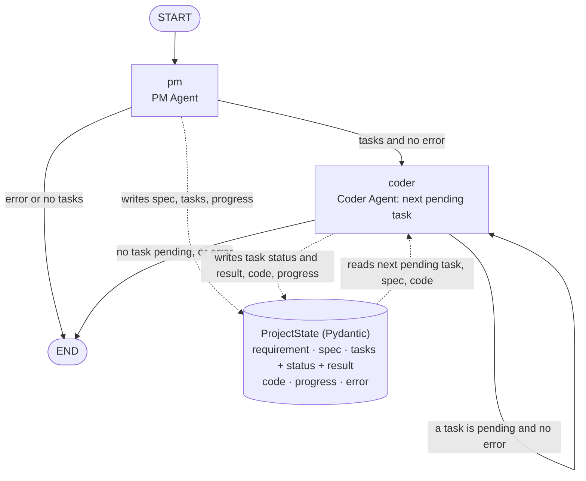

# Multi-Agent Dev Team

Final project of the **Build Autonomous Multi-Agent Systems** course (Saras AI
Institute): an autonomous software team of LLM agents that takes a natural
language requirement and produces tested, working Python code, with no human
intervention after the first prompt.

The project is built one module at a time. **Current state: Module 2 —
Multi-Agent System v2.0**: a PM Agent turns the requirement into a spec and
at most 8 tasks, and the Coder Agent (Module 1: two-tier memory, validated
tools, ReACT loop, structured output) implements them in order, both in one
LangGraph graph over a typed shared state. The QA agent
(`agents/qa_agent.py`), Docker and observability arrive in Modules 3-4.

## Framework

**[LangGraph](https://langchain-ai.github.io/langgraph/)**, for every agent and
for the orchestration (DEC-068); unchanged in Module 2. The Coder's ReACT loop is LangChain's
`create_agent`, which builds a LangGraph graph, with native tool calling and
our own middleware (DEC-069). The PM's two structured calls also use
`create_agent`, with `ToolStrategy` to get Pydantic-validated outputs
(DEC-091), and the team graph is a LangGraph `StateGraph` (DEC-094).

Why LangGraph:
- **Explicit control flow.** Nodes and conditional edges decide what runs
  next, so the limits the assessor forces (10 ReACT iterations, the QA→Coder
  loop limit, task order) are conditions in the graph, not left to the LLM.
- **Typed shared state** is native, as the PM → Coder → QA handoff needs
  (Modules 2-3).
- **The standard agent loop with hooks.** `create_agent` brings the loop, a
  model-call limit and a validated final answer; middleware adds what a
  Coder needs on top: memory injected on every call, tool arguments
  validated before any tool runs, and no task ending without the `Finish`
  tool.
- **Tracing and tests.** LangSmith traces the graph (Module 4), and fake chat
  models make the mocked agent tests simple.
- Trade-off: more code than CrewAI to define roles, and no free-form agent
  conversation (AutoGen's strength); our flow PM → Coder → QA is a fixed
  sequence with bounded loops, so neither is needed.

**LLM:** any model with tool calling through [OpenRouter](https://openrouter.ai),
used with LangChain's `ChatOpenAI` because OpenRouter speaks the OpenAI API
for every model (DEC-075); an equivalent of the GPT-4o / Claude Sonnet options
in the course guide. The Coder uses a small, fast model,
`openai/gpt-4.1-mini` (`LLM_MODEL`); the PM, which makes only 2-4 calls per
run but plans the whole project, uses a larger one, `openai/gpt-4.1`
(`PM_MODEL`) (DEC-086, DEC-093).

## Setup

Python **3.11**, with [uv](https://docs.astral.sh/uv/) (DEC-032):

```bash
uv venv --python 3.11 .venv
UV_LINK_MODE=copy uv pip install -r requirements.txt   # UV_LINK_MODE only needed on /mnt/c (WSL)
source .venv/bin/activate
cp .env.example .env    # then set OPENROUTER_API_KEY
```

Credentials only come from environment variables (`.env`, never committed).
Every setting in `.env.example` is documented there: Coder and PM models, log
level, window size, memories per call, Chroma location, script timeout (10 s by default,
30 s maximum) and the agent's workspace directory.

## Running the team

```bash
python main.py                  # the graded demo task: a Flask API with /health and /echo
python main.py "Build a CLI tool that counts word frequency in a file"
python main.py --json           # the whole final ProjectState as JSON
```

Each run goes from the requirement to the code with no human input
(DEC-096). Before it starts, everything an earlier run left in `workspace/`
is **moved, never deleted**, to `workspace_history/<timestamp>/`, so each
run starts with an empty workspace (DEC-114). The output lists:

- `[PROGRESS]`: one note per step, in order: the PM's spec and tasks
  ("handoff ready"), then "starting task_N" and "task_N done/failed" for each
  task.
- `[SPEC]`, `[ACCEPTANCE CRITERIA]` and `[TASKS]`: the PM's spec and each
  task with its priority, status, files, the spec criteria it covers, the
  tasks it was merged from (when more than 8 were consolidated), its
  Given/When/Then criteria and a `result:` line (main file, iterations,
  first line of the last run's output).
- `[WORKSPACE]`: the folder and the files the run wrote.
- `ERROR:` if the run ended with an error.
- The **verdict**, always the last line (DEC-111).

### Success or unresolved issues

A run succeeds **only** when there is no error and every task is `done`
(the Coder's result for that task was `success`: its code ran without error).
The last line and the exit code say which:

| Last line | Exit code | Meaning |
|---|---|---|
| `RESULT: success` | 0 | Every task done. |
| `RESULT: incomplete — task_2 failed` | 1 | The run finished, but the listed tasks failed (the remaining tasks still ran, DEC-097); or `no tasks were planned`. |
| `RESULT: error — <message>` | 1 | The run stopped: the PM failed, the workspace could not be archived, the Coder hit a fatal error or the step limit was reached. |
| (usage message) | 2 | Invalid usage, e.g. an empty requirement. |

With `--json` only the state is printed; the exit code still gives the
verdict, and the state's `error` and each task's `status` give the details.

### Trying the generated API

The Coder never starts a server, since a server never ends: `exec_python`
refuses a file that starts one, and the Coder checks its API with a separate
script that calls it in-process through `app.test_client()` (DEC-112,
DEC-116). The API file keeps an `if __name__ == "__main__":` block that
starts the server, so you can run it yourself:

```bash
python workspace/app.py   # the file name is the task's main file in the output
curl http://127.0.0.1:5000/health
curl -X POST -H "Content-Type: application/json" -d '{"a": 1}' http://127.0.0.1:5000/echo
```

## How the team works (Module 2)



Solid arrows are the graph's edges (`orchestration/graph.py`); dotted arrows
are reads and writes of the shared state (`orchestration/state.py`). Both
agents are nodes of the **same graph**; nothing is copied by hand between
them.

1. **`run()`** archives the workspace, creates the state with the
   `requirement` and streams the graph with a step limit of 11 (the PM, one
   step per task and a margin) that ends a runaway loop with the state kept
   (DEC-114, DEC-115).
2. **`pm`** (`agents/pm_agent.py`) makes two structured calls: the spec
   (name, description, markdown details, acceptance criteria), then the
   tasks, each with an ID, description, Given/When/Then criteria, the spec
   criteria it covers, files (at least one `.py`: every task changes code
   that can be run) and priority. Every output is validated with Pydantic
   and gets one corrective retry (DEC-083, DEC-087, DEC-088, DEC-095,
   DEC-117). More than 8 tasks are merged deterministically into 8 groups of
   consecutive tasks, keeping every covered criterion (DEC-082, DEC-092).
   The PM never raises: a failure is written to `error`.
3. **Handoff** (`route_after_pm`): the Coder runs only when the PM left no
   error and at least one task. The tasks in the state, with status
   `pending`, are the handoff; they are JSON-serializable (`--json`)
   (DEC-110).
4. **`coder`** (`agents/coder_agent.py`) runs **one task per step**: the
   first `pending` task, in priority order (DEC-085, DEC-103). It turns the
   task, its criteria, the project context and the files already written
   into the Coder's prompt and runs the Module 1 ReACT agent (DEC-098,
   DEC-105). It then sets the task's status (`done` only for a `success`
   result) and its `CoderResult`, adds the files the task wrote to `code`
   and appends progress notes (DEC-101, DEC-106, DEC-107). All the tasks of a
   run share one memory window, passed in the run context (DEC-099,
   DEC-104).
5. **`route_after_coder`** loops back while a task is pending and there is no
   error. A failed task does not stop the next ones; a fatal error does
   (DEC-097, DEC-102).

| `ProjectState` field | Written by | Read by |
|---|---|---|
| `requirement` | `run()` | PM |
| `spec`: name, description, details, acceptance criteria, tasks as planned | PM | Coder (project context), `main.py` |
| `tasks`: each `TaskSpec` plus `status` (`pending`/`done`/`failed`) and `result` (`CoderResult`) | PM creates them; the Coder updates status and result | Coder (next pending task), routers, `main.py` |
| `code`: file path → content on disk, every file the run wrote | Coder | Coder (files already written), `main.py` |
| `progress`: notes, appended by each step | `run()`, PM, Coder | `main.py` |
| `error`: empty unless the run must stop | `run()`, PM, Coder | routers, `main.py` |

## Running the Coder Agent alone (Module 1)

```bash
# Interactive session: each message is a task that runs the ReACT loop
python -m agents.coder_agent

# One task: prints the whole CoderResult as JSON
python -m agents.coder_agent "Write is_palindrome(s) in palindrome.py and test it"
```

The agent works inside `workspace/` (git-ignored, set by `WORKSPACE_DIR`): every path it uses is
confined there, and scripts run in a child process with a timeout and without
the agent's credentials. `LOG_LEVEL=INFO` logs the plan, one line per
iteration (tool called, or a text answer sent back) and one per LLM call
(window size and memories retrieved); `LOG_LEVEL=DEBUG` adds the full LLM
input.

### How it works

- **Plan** (`agents/coder_agent.py`): before the loop, one LLM call returns
  a Pydantic-validated `Plan`; it goes into the loop's prompt and into the
  output. It does not count as an iteration (DEC-070, DEC-071).
- **ReACT loop**: a `create_agent` graph with native tool calling, at most
  **10 model calls** per task (DEC-069, DEC-079). Each response calls exactly
  one tool (DEC-074), and every tool has a required `thought` argument, the
  Thought of that step (DEC-072). The task ends only through the `Finish`
  tool (`main_file` or null, `explanation`), validated with Pydantic; a
  response with text and no tool call goes back to the model as an error
  and counts as an iteration (DEC-073).
- **Tools** (`tools/`): `read_file`, `write_file`, `exec_python`. The model
  sees the lab schemas plus `thought` (`tools/agent_tools.py`); a middleware
  validates every call with strict Pydantic models before it runs, and
  `dispatch_tool` validates again and never raises, so invalid arguments
  never reach a tool (DEC-042, DEC-062, DEC-076).
- **Memory** (`memory.py`): a sliding window of the last N tasks of the
  session (each task with all its iterations is one turn), and a Chroma
  semantic store queried **before every LLM call** (the plan call and each
  call of the loop), whose results are injected into the system prompt. It
  stores each task and the outcome of each finished task (DEC-049, DEC-057,
  DEC-058, DEC-077).

### Output and statuses

Every task returns a `CoderResult` (Pydantic) with `status`, `plan` (from
the planning step), `code` (read from the main file on disk), `explanation`,
`result` (output of the last real execution), `main_file`, `iterations` and
`steps` (thought, action, input and observation of each step). It is computed
from the agent's messages after the run (DEC-078).

The status describes the evidence the task produced, not the kind of
request:

| Status | Meaning |
|---|---|
| `success` | `Finish` with a main file this task wrote or ran; the file exists and its last run (with no file written after it) ended without error. |
| `failed_execution` | `Finish` with a main file, but the last valid run failed. |
| `unverified` | `Finish` with a main file but no valid run: never ran, files changed after the run, or the declared file does not exist. |
| `answered` | `Finish` without code from this task (for example a question, even one about a file from an earlier task); nothing was executed (DEC-056, DEC-080). |
| `max_iterations` | 10 model calls without `Finish`. |

Only `success` means the code was checked by a real execution.

## Tests

```bash
pytest tests/                                      # every mocked test, no LLM calls
pytest tests/ --run-llm                            # also the tests with the real LLM (costs tokens)
pytest tests/test_integration_pipeline.py --run-llm -k graded_demo   # only the graded demo
CHROMA_PATH=.chroma-test python -m tests.test_memory   # Lab 1.1 recall test, real LLM
```

Every test runs in a temporary workspace, so your `workspace/` is never
touched. Without `--run-llm`, a test that would reach a real model fails
instead of calling it; the tests marked `llm` are skipped, and with
`--run-llm` and no API key they fail.

| Area | Files | What they check |
|---|---|---|
| Tools | `test_file_io.py`, `test_code_executor.py`, `test_server_guard.py` | File reads and writes, script output, errors and timeouts, and that a file starting a web server is never run (DEC-116) |
| PM | `test_pm_agent.py`, `test_llm_helpers.py` | Spec and task schemas (every task has a `.py` file), the corrective retry, consolidation of more than 8 tasks with every criterion still covered |
| Shared state | `test_state.py` | Invalid values are rejected and the state survives a JSON round trip |
| Coder node | `test_coder_node.py` | One task per step: its prompt, status, result and accumulated code; failures and fatal errors |
| Graph | `test_pipeline.py`, `test_integration_pm.py`, `test_integration_coder.py`, `test_integration_pipeline.py` | The PM → Coder handoff in one graph (after the PM step the state holds a non-empty, valid task list, and the Coder receives each task's ID, description and criteria), task order, progress after each task, 8 tasks within the step limit, the step limit itself, workspace archive |
| Entry point | `test_main.py` | Output, `RESULT:` verdict and exit codes |
| Real LLM (`llm`) | `test_smoke.py`, `test_integration_pm.py`, `test_integration_coder.py`, `test_integration_pipeline.py` | A Coder task run and its code executed; the PM's spec for the demo task; the **graded demo** run through PM and Coder, whose API passes the request fixture in `tests/api_fixture.py` (`GET /health`, `POST /echo`, and 400 for each body that is not JSON) both in-process and as a real server |
| Request fixture | `test_api_fixture.py` | The fixture passes a correct API and fails one that answers 415 to a body that is not JSON (DEC-118) |

The mocked tests use scripted fake chat models (`tests/fakes.py`), so they
check the agents' and the graph's behavior without an API key.

## Repository layout

```
main.py          entry point: runs the team for a requirement
agents/          coder_agent.py (Coder and its graph node), pm_agent.py (PM node),
                 llm_helpers.py (validated structured calls), qa_agent.py (Module 3)
tools/           file_io.py, code_executor.py, handlers.py (validation, dispatch), schemas.py,
                 agent_tools.py (LangChain adapter)
orchestration/   graph.py (team graph and run()), state.py (shared state), workspace.py (archive)
tests/           pytest tests, fakes, the API request fixture (api_fixture.py)
docs/            decisions.md, improvements.md, specs/ (one per lab), labs/, course_reference.txt
memory.py        two-tier memory
llm_client.py    shared chat model (ChatOpenAI → OpenRouter)
workspace/       the agents' working folder (git-ignored)
workspace_history/  files of earlier runs (git-ignored)
```

`Dockerfile` and `docker-compose.yml` are placeholders until Module 4.

## Design decisions (Module 1)

Key decisions by rubric criterion. The full record, with the alternatives
considered, is in [`docs/decisions.md`](docs/decisions.md); the code cites
each `DEC-NNN` it applies. Ideas beyond the requirements are in
[`docs/improvements.md`](docs/improvements.md).

**C1.1 Project setup**
- Labs live inside the required scaffold; shared modules (`memory.py`,
  `llm_client.py`) sit at the root, split by responsibility — DEC-001,
  DEC-033, DEC-035
- LangGraph as the framework; the Coder is a `create_agent` graph —
  DEC-068, DEC-069
- LLM through OpenRouter with LangChain's `ChatOpenAI`; model set by
  `LLM_MODEL` and passed per agent — DEC-002, DEC-075
- Python 3.11 locally via uv — DEC-032

**C1.2 Memory**
- The window keeps the last N turns; a turn is one task with all its
  iterations — DEC-004, DEC-048, DEC-057
- Chroma with local embeddings (no extra API key) and an on-disk store, so
  memories survive between runs — DEC-003
- Retrieval runs before every LLM call (a middleware rebuilds the input of
  each model call), queried by the task, and its results go into the system
  message; memories already in the window are skipped — DEC-015, DEC-016,
  DEC-050, DEC-058, DEC-077
- Stored: each task and the outcome of each finished task, not tool
  observations — DEC-049, DEC-059
- A failed LLM call raises and leaves the window untouched — DEC-027,
  DEC-028, DEC-031
- Every LLM call logs the window state and the memories retrieved — DEC-025

**C1.3 Tools**
- File tools work only inside `workspace/`; arguments are validated by strict
  Pydantic models — DEC-036, DEC-042
- Scripts run in a subprocess with a 10 s default timeout (env var, 30 s
  cap); on timeout the whole process group is killed — DEC-037, DEC-044,
  DEC-045
- Scripts get an allowlisted environment, so no credentials — DEC-039,
  DEC-043
- `exec_python` always returns a useful text (output, exit code or timeout)
  — DEC-038
- Every tool call is validated with strict Pydantic models before the tool
  runs, with short error messages; `dispatch_tool` validates again and never
  raises — DEC-062, DEC-067, DEC-076

**C1.4 ReACT loop**
- Native tool calling in a `create_agent` loop; at most 10 model calls,
  enforced by LangChain's call limit placed last in the middleware —
  DEC-069, DEC-070, DEC-079
- A validated `Plan` before the loop — DEC-071
- Every tool call carries a `thought`; one tool per call; the task ends only
  through `Finish`, and text answers go back as errors — DEC-072, DEC-073,
  DEC-074
- Every step is recorded in `steps` — DEC-078

**C1.5 Structured output**
- `CoderResult` (Pydantic) is the output of a whole task — DEC-065
- `code` is read from the main file the agent declares, so it matches the
  written artifact — DEC-052
- `result` comes from the last real execution with no file written after it;
  the status says how the task ended — DEC-055, DEC-056, DEC-063
- A declared main file only counts if this task wrote or ran it; an existing
  file from an earlier task makes the answer `answered`, a missing one
  `unverified` — DEC-080

**C1.6 Verification**
- The smoke test runs a real task with the real LLM (opt-in with
  `--run-llm`) and checks the generated code's behavior in a subprocess —
  DEC-054, DEC-066

**Known simplifications** (provisional, to revisit)
- Memory deduplication only catches exact repeats — DEC-011
- One run id per process, no session id — DEC-014
- Retrieval returns the top K without a relevance threshold — DEC-017
- LLM retries are `ChatOpenAI`'s defaults until Module 4 (C4.2) — DEC-075

## Design decisions (Module 2)

Specs with the acceptance criteria and tests of each lab:
[`docs/specs/`](docs/specs/) (PM Agent, Coder node, pipeline).

**C2.1 Specification**
- The PM is a fixed two-call pipeline, spec then tasks, on a larger model
  (`PM_MODEL`); it never raises, failures end in `error` — DEC-086, DEC-087,
  DEC-093
- The spec has name, description, markdown details and acceptance criteria;
  every criterion must be covered by a task — DEC-083
- 2 to 8 tasks, as few as the requirement allows; several tasks may extend
  the same file; every task changes Python code — DEC-081, DEC-084, DEC-117
- Task criteria are structured Given/When/Then — DEC-095
- Each structured call is Pydantic-validated (`create_agent` with
  `ToolStrategy`) and an invalid output gets one corrective retry —
  DEC-088, DEC-091

**C2.2 Shared state**
- `ProjectState` is a Pydantic model; the graph is built on it — DEC-089
- The spec keeps the tasks as planned; `tasks` holds them as executed, with
  status and `CoderResult` — DEC-090, DEC-101, DEC-107
- `code` holds the files each task actually wrote, read from disk — DEC-106

**C2.3 Handoff**
- PM and Coder are nodes of one LangGraph graph in `orchestration/` —
  DEC-094, DEC-100
- The Coder runs only when the PM left no error and at least one task;
  the pending tasks in the state are the handoff — DEC-110
- The node turns a task (ID, description, criteria, files) plus the project
  context and existing files into the Coder's prompt — DEC-098, DEC-105

**C2.4 Execution and progress**
- Priority is the execution order; the Coder runs the first pending task,
  one per step, and loops while tasks are pending — DEC-085, DEC-103
- More than 8 tasks are merged into 8 even groups of consecutive tasks,
  keeping their criteria and `merged_from` — DEC-082, DEC-092
- A failed task does not stop the others; a fatal error ends the run — DEC-097,
  DEC-102
- One memory window per run, shared by its tasks and passed in the run
  context — DEC-099, DEC-104, DEC-109
- A step limit of 11 (the PM, 8 tasks and a margin) ends a runaway loop and
  keeps the state — DEC-115

**C2.5 Working two-agent system**
- Flask is a project dependency, so generated APIs can run — DEC-108
- The Coder never runs a server: `exec_python` refuses a file that starts
  one, and APIs are checked with a script that calls them in-process; the
  API file still serves when run with `python` — DEC-112, DEC-116
- A body that is not JSON gets 400 whatever its content type, and the
  request fixture checks four such bodies — DEC-118
- A run succeeds only with no error and every task done; the verdict line
  and the exit code say so — DEC-111

**C2.6 Explanation**
- Framework unchanged from Module 1 (LangGraph) — DEC-068
- `main.py` runs the graded demo by default and can print the state as JSON
  — DEC-096

**Known simplifications** (provisional, to revisit)
- Each run starts with an empty workspace (earlier files are archived to
  `workspace_history/`); continuing an existing project is a future
  improvement (IMP-011) — DEC-114
- After a fatal error, `code` may miss files the failed task wrote (IMP-009)
